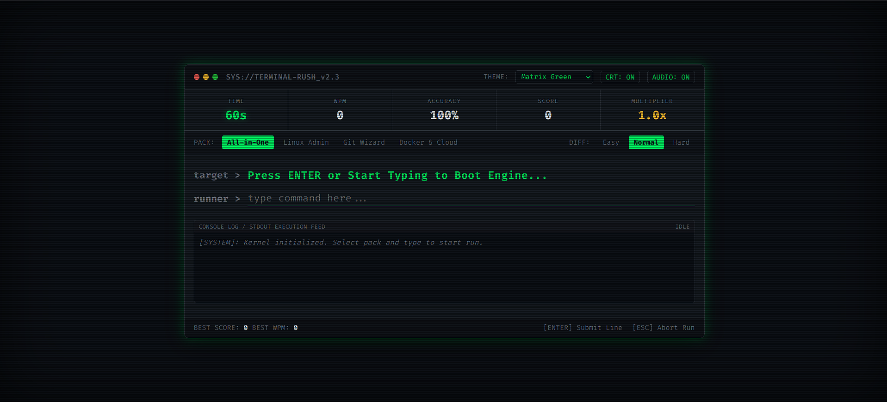

# TERMINAL RUSH ⚡ // v2.3

A fast-paced cybernetic typing arcade game with authentic CRT aesthetics, synthesized 8-bit soundscapes, and simulated shell command execution. Race against a 60-second clock to type terminal commands, utility scripts, and cloud workflows.

🎮 **Live Playable Demo:** [https://skanda-sh.github.io/terminal-rush/](https://skanda-sh.github.io/terminal-rush/)



---

## ✨ Engineering Features

- **Synthesized 8-Bit Web Audio Engine:** Generates real-time audio waveforms (sine, sawtooth, triangle waves) directly via the native browser `AudioContext` API—zero external audio files or network requests required.
- **Simulated `stdout` Execution Feed:** Intercepts successful command executions to output realistic shell/CLI stdout streams (Git hash logs, Docker pull manifests, Linux process tables).
- **Fisher-Yates Shuffle Queue:** Replaced uniform random command selection with an in-memory shuffled deck to guarantee zero back-to-back command repetition across sessions.
- **Dynamic CRT Phosphor Themes:** Instant theme toggles between Matrix Cyber Green, Amber CRT Phosphor, Synthwave Neon, and Ghost White Monochrome.
- **Config Lockdown & Standby Engine:** Prevents config drift mid-run by locking selectors during gameplay, paired with a dual-action session debrief card (`Space` to retry, `Esc` to return to config menu).
- **Audio-Visual Countdown Warning:** Critical 10-second timer pulse accompanied by synchronized pitch-shifting audio ticks.
- **Zero Dependencies:** Pure vanilla ES6+ JavaScript, CSS3 variables/keyframes, and semantic HTML5.

---

## 📦 Command Packs & Difficulty Tiers

| Pack | Focus Areas | Example Commands |
| :--- | :--- | :--- |
| **Linux Admin** | Core utilities, permissions, monitoring | `systemctl status nginx`, `grep -rnw './logs'`, `tar -czvf` |
| **Git Wizard** | Version control workflows, branch mechanics | `git checkout -b feature/auth`, `git rebase -i HEAD~3`, `git cherry-pick` |
| **Docker & Cloud** | Containerization & Kubernetes orchestration | `docker compose up -d`, `kubectl get pods`, `docker system prune` |
| **All-in-One** | Balanced combination across all environments | Random balanced mix across all domains |

---

## 🧮 Performance Metrics & Scoring

* **Base Keystroke Points:** 10 points per valid character typed.
* **Speed Velocity Bonus:** Up to 50 bonus points when clearing a line under 4 seconds.
* **Dynamic Multiplier:** Consecutive clean submissions increment the combo multiplier up to 3.0×.
* **Typing Speed (WPM):** `(Correct Characters ÷ 5) ÷ Elapsed Minutes`
* **Keystroke Precision:** `(Total Valid Characters ÷ Total Keystrokes) × 100%`
* **Local Persistence:** High scores and peak WPM persist via the browser's `localStorage` API.

---

## 💻 Local Development

Clone and open immediately in any modern web browser:

```bash
# Clone repository
git clone [https://github.com/skanda-sh/terminal-rush.git](https://github.com/skanda-sh/terminal-rush.git)
cd terminal-rush

# Run locally (Windows PowerShell)
start index.html

# Run locally (Linux / Ubuntu)
xdg-open index.html
```

---

## 📄 License

Distributed under the MIT License. See `LICENSE` for details.